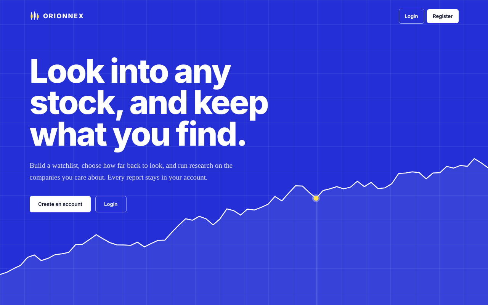
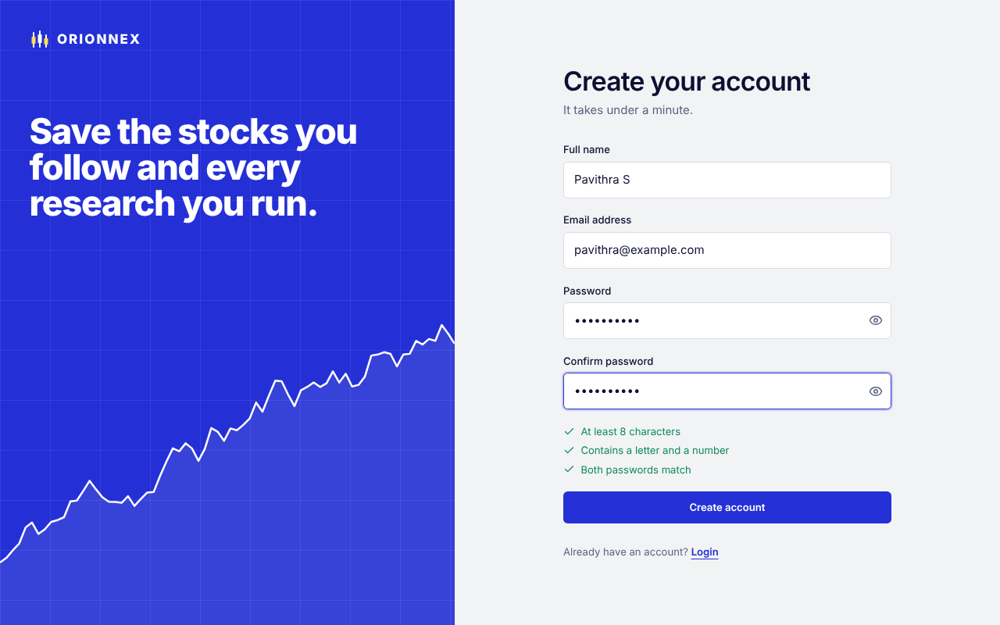
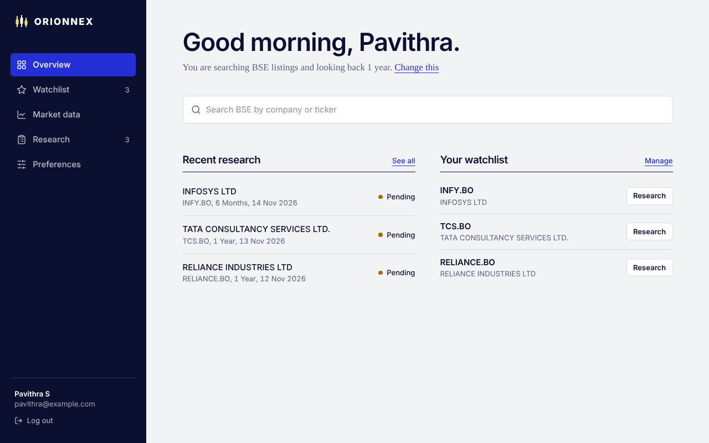
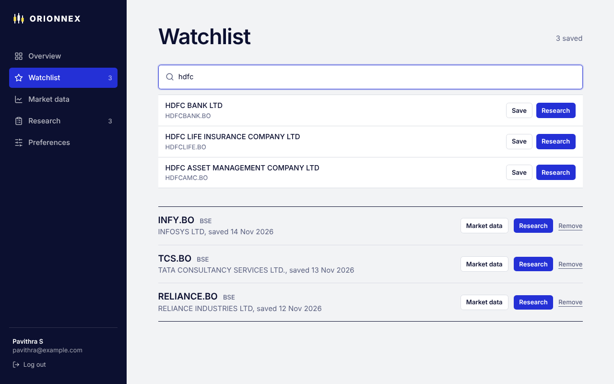
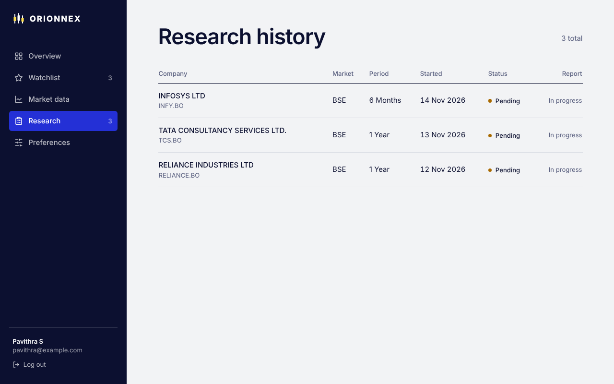
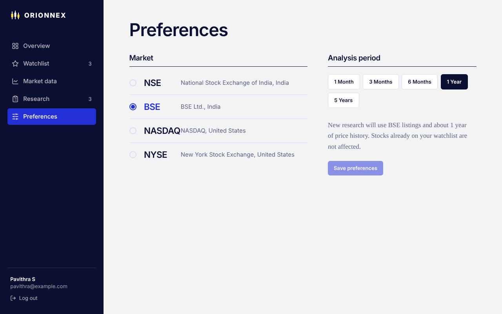
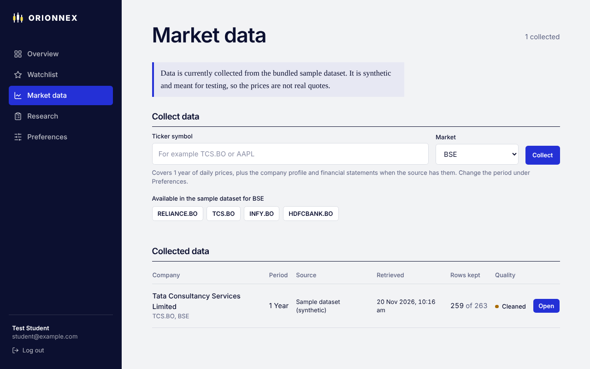
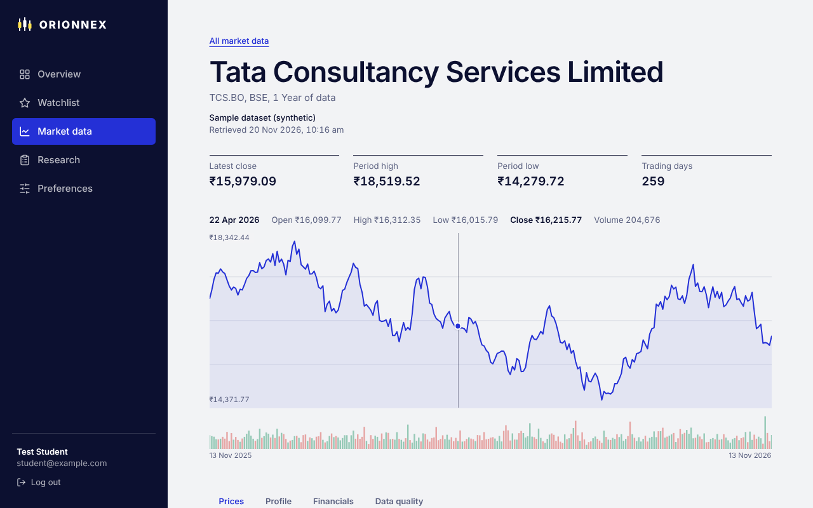
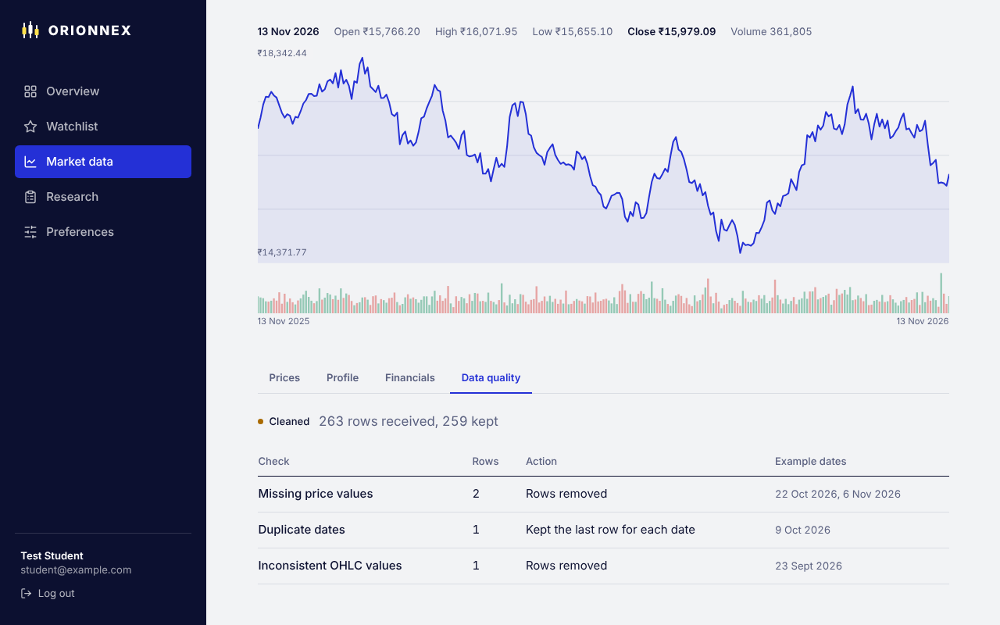
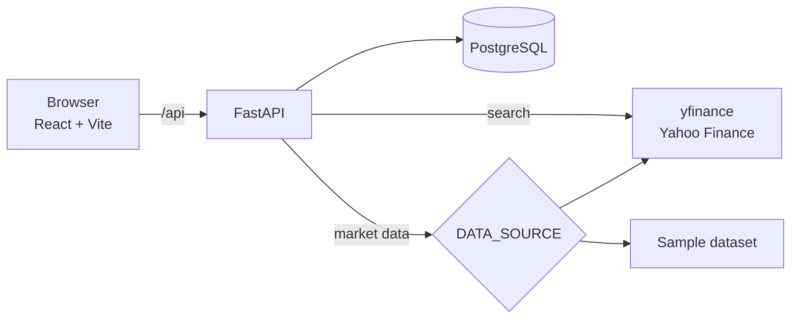

<h1 align="center">ORIONNEX</h1>

<p align="center">
  Multi-agent stock research system<br>
  <sub>Module 1: accounts and research workspace | Module 2: stock search and market data collection</sub>
</p>

<p align="center">
  
  
  
  
  
</p>

<p align="center">
  
</p>

<p align="center">
  <a href="#overview">Overview</a> |
  <a href="#screenshots">Screenshots</a> |
  <a href="#architecture">Architecture</a> |
  <a href="#getting-started">Getting started</a> |
  <a href="#api">API</a> |
  <a href="#security">Security</a> |
  <a href="#troubleshooting">Troubleshooting</a>
</p>

## Overview

ORIONNEX is a multi-agent stock research system. This repository currently contains two modules that the later analysis modules build on.

**Module 1: accounts and research workspace**

- Registration and login with JWT authentication
- A protected dashboard, available only to signed-in users
- A per-user watchlist, searched through Yahoo Finance (`yfinance`)
- Per-user preferences for market (NSE, BSE, NASDAQ, NYSE) and analysis period (1 month to 5 years)
- A per-user research history recording market, period, date and status for each task

**Module 2: stock search and market data collection**

- Company search by name or ticker for the selected market
- Historical daily prices as OHLCV (open, high, low, close, volume)
- Company profile and financial statements (income statement, balance sheet, cash flow) where the source has them
- The data source and retrieval time recorded for every collection
- Validation and cleaning of missing values, duplicate dates and inconsistent prices, with a report of what was found
- Support for NSE, BSE, NASDAQ and NYSE

> [!NOTE]
> New research tasks are stored with the status `Pending`. The agents that process tasks and produce reports are outside this module. They will update the status and report columns that already exist in the database.

## Screenshots

<table>
  <tr>
    <td width="50%"><br><sub>Registration with live password checks</sub></td>
    <td width="50%"><br><sub>Dashboard overview</sub></td>
  </tr>
  <tr>
    <td width="50%"><br><sub>Watchlist with yfinance search</sub></td>
    <td width="50%"><br><sub>Research history</sub></td>
  </tr>
  <tr>
    <td width="50%"><br><sub>Market and analysis period preferences</sub></td>
    <td width="50%"><br><sub>Collecting market data</sub></td>
  </tr>
  <tr>
    <td width="50%"><br><sub>Collected prices with source and retrieval time</sub></td>
    <td width="50%"><br><sub>Data quality report</sub></td>
  </tr>
</table>

<sub>Screenshots were taken with sample data. The market data screens show the synthetic sample dataset.</sub>

## Architecture



The frontend talks only to the FastAPI backend. The backend stores accounts, preferences, watchlists, research tasks and collected market data in PostgreSQL. Company search goes to yfinance. Market data collection reads from the source chosen by `DATA_SOURCE`, which is the bundled sample dataset by default.

### Stack

| Area | Technology |
|---|---|
| Frontend | React, Vite, Tailwind CSS, React Router |
| Backend | FastAPI, SQLAlchemy 2, Pydantic |
| Database | PostgreSQL |
| Authentication | PyJWT, bcrypt |
| Market data | yfinance |

### Repository layout

```
backend/
  app/
    main.py          application entry point
    config.py        environment configuration
    database.py      engine and session
    models.py        users, user_preferences, saved_stocks, research_tasks
    schemas.py       request and response models
    security.py      password hashing and token handling
    deps.py          current-user and CSRF dependencies
    market.py        yfinance search and ticker validation
    marketdata/      data collection (module 2)
      providers/     sample dataset and yfinance sources
      validation.py  checks and cleaning for OHLCV data
      collector.py   retrieves, validates and stores a collection
    routers/         auth, preferences, watchlist, research, marketdata
  data/sample/       model dataset used for market data and tests
  scripts/           generate_sample_data.py rebuilds the model dataset
  tests/             automated tests
  init_db.py         creates the database and tables
  schema.sql         the same schema as plain SQL
  requirements.txt
  requirements-dev.txt
  .env.example
frontend/            React application
docs/screenshots/    images used in this README
```

## Getting started

### Requirements

- Python 3.10 or later
- Node.js 18 or later
- PostgreSQL 14 or later
- Internet access, since search and price checks go through Yahoo Finance

### 1. Clone

```
git clone https://github.com/springboardmentor23232a-eng/AI-Powered-Multi-Agent-System-for-Market-Analysis-and-Research.git
cd AI-Powered-Multi-Agent-System-for-Market-Analysis-and-Research
git checkout Pavithra-S
```

### 2. Backend

```
cd backend
pip install -r requirements.txt
```

Copy `.env.example` to `.env` (`copy` on Windows, `cp` elsewhere) and set the values for your machine:

```
DB_HOST=localhost
DB_PORT=5432
DB_USER=postgres
DB_PASSWORD=<your PostgreSQL password>
DB_NAME=stock_research
SECRET_KEY=<a long random string>
ACCESS_TOKEN_EXPIRE_MINUTES=60
COOKIE_SECURE=false
DATA_SOURCE=sample
```

| Variable | Purpose |
|---|---|
| `DB_PASSWORD` | PostgreSQL password. It may contain any characters. |
| `SECRET_KEY` | Signs session tokens. Keep it private. |
| `COOKIE_SECURE` | `false` for local HTTP, `true` for any HTTPS deployment. |
| `DATA_SOURCE` | `sample` (default) collects market data from the bundled model dataset. `yfinance` collects live data. |
| `DATABASE_URL` | Optional. A complete URL can be set instead of the `DB_*` values. |

> [!IMPORTANT]
> Do not commit `.env`. It holds the database password and the signing key, and is excluded through `.gitignore`.

With PostgreSQL running, create the database and tables:

```
python init_db.py
```

Successful output ends with `Tables ready:` followed by the table names (users, user_preferences, saved_stocks, research_tasks, data_collections, price_bars).

### 3. Frontend

```
cd frontend
npm install
```

### 4. Run

Start the backend from `backend/`:

```
python -m uvicorn app.main:app --reload
```

The API listens on http://localhost:8000, with interactive documentation at http://localhost:8000/docs.

In a second terminal, start the frontend from `frontend/`:

```
npm run dev
```

Open http://localhost:5173. The development server proxies `/api` to port 8000, so both processes need to be running.

### 5. Verify

1. Register an account, then log in.
2. Search for a company (for example `tcs` with BSE selected) and add it to the watchlist.
3. Change the market or period under Preferences and save.
4. Start research from a saved stock and confirm a `Pending` entry appears in the history.
5. Open Market data, pick a ticker (for example `TCS.BO` with BSE) and select Collect. Check the prices, profile and financials, then the Data quality tab.
6. Register a second account and confirm it sees none of the first account's data.

Stored records can be inspected with `psql` or pgAdmin, for example `SELECT user_id, email FROM users;`.

## Market data collection

Open **Market data** in the dashboard, choose a ticker and select **Collect**. The backend retrieves the data from the active source, validates and cleans it, and stores one collection for your account. Each collection keeps the cleaned daily prices, the company profile and financial statements when available, the name of the source, the exact retrieval time, and the validation report. The period comes from your saved preferences.

### Validation

Checks run in this order. Each runs on the rows left by the previous check, so a row is counted under the first problem found in it.

| Check | Rule | Action |
|---|---|---|
| Invalid dates | The date cannot be read | Row removed |
| Missing price values | Open, high, low or close is empty | Row removed |
| Duplicate dates | The same date appears more than once | Last row kept |
| Non-positive values | A price of zero or less, or a negative volume | Row removed |
| Inconsistent OHLC | High is below low, or open or close lies outside the high-low range | Row removed |
| Missing volume | Volume is empty | Filled with 0 |

The cleaned data has one row per trading date in date order. The report lists how many rows each check affected and example dates.

### Data sources

`DATA_SOURCE=sample` is the default. It reads the model dataset in `backend/data/sample/`: daily prices for 15 symbols across NSE, BSE, NASDAQ and NYSE, with a profile and financial statements for each. **The dataset is synthetic.** The prices come from a seeded random walk and the financial figures are invented, so they are not real quotes or reported results. A few rows in five symbols (`TCS.BO`, `INFY.BO`, `RELIANCE.BO`, `HDFCBANK.NS`, `AAPL`) are broken on purpose so the validation has known defects to find. `defects.json` lists them. The dataset is static, so periods are counted back from its last date (13 Nov 2026).

`DATA_SOURCE=yfinance` collects live data from Yahoo Finance and needs no other change. Company search in the watchlist always uses yfinance, so a searched company may not exist in the sample dataset. In that case the collection reports that the symbol is not in the sample dataset.

To rebuild the sample dataset, run `python scripts/generate_sample_data.py` from `backend/`.

## Tests

The tests run only against the sample dataset and a temporary database. They never call yfinance.

```
cd backend
pip install -r requirements-dev.txt
python -m pytest
```

They cover each validation check, the exact defects planted in the model dataset, the sample provider, and the collection API, including login, CSRF and separation between users.

## API

All routes are under `/api`. Everything except registration and login requires an authenticated session.

| Method | Route | Description |
|---|---|---|
| POST | `/auth/register` | Create an account |
| POST | `/auth/login` | Authenticate and set the session cookie |
| POST | `/auth/logout` | Clear the session cookie |
| GET | `/auth/me` | Return the current user |
| GET, PUT | `/preferences` | Read or update market and analysis period |
| GET | `/stocks/search?q=&market=` | Search listings through yfinance |
| GET, POST | `/watchlist` | List or add saved stocks |
| DELETE | `/watchlist/{id}` | Remove a saved stock |
| GET, POST | `/research` | List history or start a research task |
| GET | `/research/{id}` | Retrieve a single task |
| GET | `/market-data/source` | Active data source and the symbols it covers |
| POST | `/market-data/collect` | Collect, validate and store data for a ticker |
| GET | `/market-data` | List your collections |
| GET | `/market-data/{id}` | One collection with its profile, financials and validation report |
| GET | `/market-data/{id}/prices` | Cleaned daily prices for a collection |

## Security

- Passwords are hashed with bcrypt. Plain-text passwords are never stored or logged.
- The session token is a JWT carrying only the user id and an expiry time. It is delivered in an HTTP-only, SameSite=Lax cookie.
- State-changing requests must include an `X-Requested-With` header, which guards against cross-site request forgery.
- The user id is always taken from the verified token, never from request data. Every query for watchlist, preferences and research history is filtered by it.
- Before a stock is saved or a task is created, the ticker is normalised for the selected market (`.NS` for NSE, `.BO` for BSE) and checked against yfinance for price data over the chosen period.

## Troubleshooting

<details>
<summary>Common problems and fixes</summary>

<br>

| Symptom | Cause and fix |
|---|---|
| `uvicorn` is not recognised on Windows | Run it through Python: `python -m uvicorn app.main:app --reload` |
| Connection refused when running `init_db.py` | PostgreSQL is not running. Start the service. |
| Password authentication failed | `DB_PASSWORD` does not match the PostgreSQL user's password. |
| `KeyError: 'SECRET_KEY'` | `backend/.env` is missing or does not define `SECRET_KEY`. |
| A ticker is "not in the sample dataset" | Collect one of the listed sample symbols, or set `DATA_SOURCE=yfinance` in `backend/.env` and restart the backend. |
| Stock search returns nothing or fails | Upgrade with `pip install -U yfinance`. A "Too Many Requests" response is a temporary rate limit. Some networks block Yahoo Finance. |
| Frontend loads but requests fail | The backend is not running on port 8000. |
| `npm` is not recognised | Install Node.js and open a new terminal. |

</details>

## License

Released under the MIT License. See [LICENSE](LICENSE).
